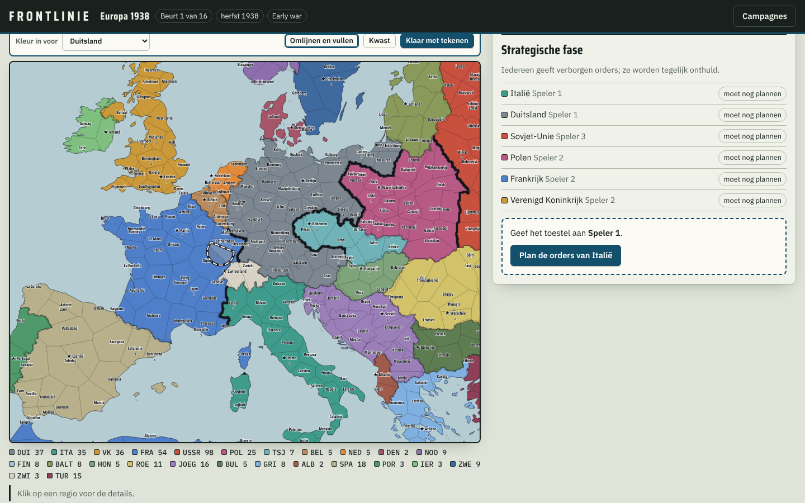
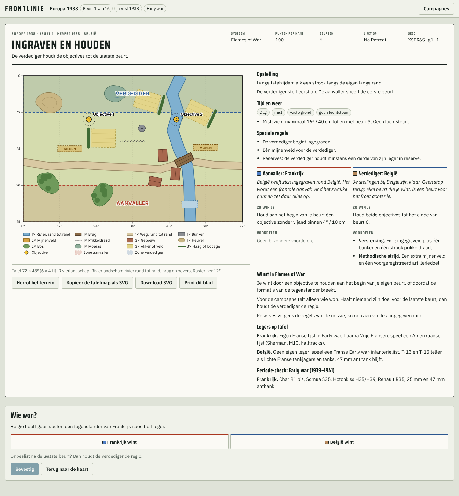

# Frontlinie

Campagnekaart en scenariogenerator voor **Flames of War** en **Battlegroup**. Jullie kiezen op de kaart van Europa wat je aanvalt; Frontlinie maakt van elk gevecht een scenario met objective, briefing en tafelmap. Het gevecht speel je op tafel, daarna klik je aan wie won.

Het is een hulpmiddel bij het bordspel, geen computerspel: er is geen AI en de app beslist geen gevechten.



## Starten

Open **`frontlinie.html`** in een browser. Dat is alles: één bestand, geen installatie, geen server, werkt ook op een telefoon of tablet. Campagnes worden op het toestel zelf bewaard; met *Exporteer* zet je er één over naar een ander toestel.

## Wat erin zit

- **Kaart van Europa** met echte grenzen en kustlijnen, ruim 400 provincies rond echte steden, drie startdata: **1938**, **1941** en **1945** (plus de what-if Seelöwe). De periode volgt de kalender: Early war tot 1941, Mid war 1942–43, Late war vanaf 1944.
- **Gebied tekenen.** Op de Europakaart is gebied geen tegel maar een ingekleurd vlak. Met *Teken gebied* trek je een lijn rond het veroverde gebied en bij loslaten wordt het ingekleurd (er is ook een kwast). Grenzen en frontlijn lopen grillig als een kustlijn en volgen wat je tekent. Een regio is van wie het grootste deel ervan heeft ingekleurd.
- **Alle landen.** Elk land heeft een eigen logische doctrine. Landen zonder eigen Flames of War-leger krijgen een logisch leger om op tafel te zetten (Nederland speelt een Franse of Britse infanterielijst, Zweden een Duitse lijst met Panzer 38(t), enzovoort).
- **Landen met en zonder speler.** Een land zonder speler geeft geen orders en verdedigt alleen; een tegenstander van de aanvaller speelt dan zijn leger. Een neutraal land dat wordt aangevallen, kiest de andere kant.
- **13 operaties** op een eigen kaart: Fall Weiss, Fall Gelb, Compass, Barbarossa, Fall Blau, El Alamein, Koersk, Sicilië, Overlord, Bagration, Market Garden, Ardennen, Val van het Rijk.
- **Orders per beurt**, verborgen of om de beurt: aanvallen, versterken, verdedigen, recon, bevoorrading, en doctrine-orders (landing, luchtlanding, raid, partizanen, aanval voorbereiden).
- **16 scenariotypes** uit gewogen tabellen, bepaald door de regio (terrein, brug, stad, versterking), de orders, de bevoorrading, de doctrines, het seizoen en wat er eerder in de regio gebeurde.
- **Tafelmap** op schaal, gebouwd uit jouw terreinvoorraad en nooit met meer stukken dan je hebt. Als SVG te kopiëren, te downloaden of te printen samen met het scenario.
- **Altijd gelijke punten.** Voordelen komen uit het scenario en de doctrine, nooit uit extra punten.
- **Seeds.** Elk scenario en elke tafelmap is exact te herhalen.



## Een beurt

1. Elke speler plant zijn orders (geef het toestel door; orders van anderen blijven verborgen).
2. Onthullen: de app bepaalt de gevechten. Twee landen die elkaar over dezelfde grens aanvallen, spelen één ontmoetingsgevecht.
3. Per gevecht: scenario en tafelmap openen, opbouwen, spelen.
4. Aanklikken wie won. De aanvaller wint: regio veroverd. De verdediger wint (of het blijft onbeslist): regio blijft en hij krijgt een tegenaanval-optie.
5. Beurt afsluiten. Afgesneden regio's capituleren na drie beurten.

## Voor wie eraan wil sleutelen

```
src/kaarten.js        kaarten van de operaties (regio's als tekstregels)
src/europa-geo.js     gegenereerde Europakaart (niet met de hand bewerken)
src/campagnes.js      landen, legers, startopstellingen
src/doctrines.js      doctrines per land en periode
src/engine.js         campagneregels: orders, conflicten, bevoorrading, uitslag
src/scenario.js       scenariogenerator
src/tafel.js          tafelmapgenerator en SVG
src/ui-verf.js        tekenlaag: ingekleurd gebied en grillige frontlijnen
src/ui*.js, stijl.css interface
tools/                maakt de Europakaart uit Natural Earth
tests/                regeltests, volledige campagnes, browsertest
```

```
node build.js                 # bouwt frontlinie.html uit src/
npm test                      # regeltests + elke campagne drie keer volledig uitgespeeld
node tests/e2e.cjs            # speelt campagnes in een echte browser (Playwright)
```

De Europakaart opnieuw maken na een wijziging in `tools/europa-regios.mjs` (regio's) of `tools/europa-provincies.mjs` (provincies):

```
npm install --no-save world-atlas topojson-client
node tools/maak-europa.mjs
```

De omtrekken komen uit Natural Earth (public domain) en volgen dus de huidige landsgrenzen; de grenzen van 1938 zijn daarop benaderd door regio's toe te wijzen (Silezië, Pommeren en Masuren bij Duitsland, Galicië en Brest bij Polen).

Het oorspronkelijke ideeëndocument staat in [docs/ideeen.md](docs/ideeen.md).
